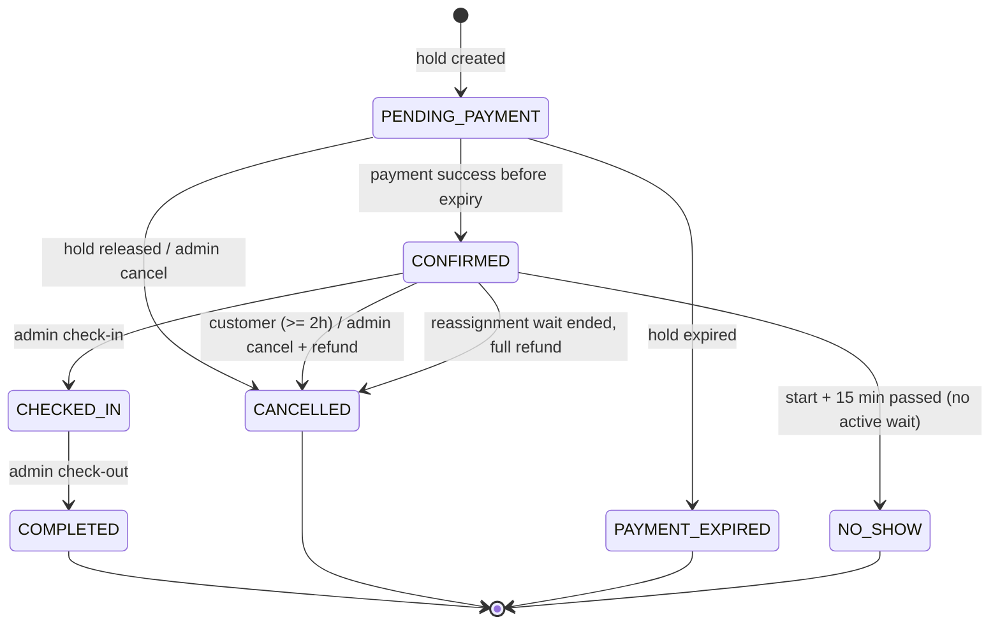

# ParkIt --- System Architecture and Design

**Version:** 2.0 (revised after design review, 2026-11-15)\
**Architecture style:** Layered modular monolith with REST APIs\
**Backend:** Java 21, Spring Boot 3.x\
**Frontend:** Static HTML, CSS, JavaScript, Bootstrap (served by Spring
Boot from `/static`)\
**Database:** PostgreSQL 16+, Flyway migrations\
**Status:** Approved baseline (2.1). Frontend technology is provisional
until the UCS553 rubric is verified.

## 1. Overview

```text
Browser: Customer portal / Admin dashboard (HTML + JS + Bootstrap)
        |  fetch() JSON over HTTP, session cookie + CSRF token
Spring Boot application (single instance)
  ├── Security filter chain (session auth, CSRF, role rules)
  ├── Controllers (REST, DTO validation)
  ├── Services (use cases, transactions, business rules)
  │     └── Domain model (entities with state transitions, enums, policies)
  ├── Repositories (Spring Data JPA + native SQL)
  ├── Schedulers (hold expiry, no-show)
  └── Gateway adapters (SimulatedPaymentGateway)
        |
PostgreSQL (schema owned by Flyway)
```

A modular monolith suits a single-facility academic project: one
deployable, one database, simple testing.

## 2. Decisions

| Area | Decision |
|---|---|
| JDK | Java 21 (LTS) |
| Framework | Spring Boot 3.x (latest supported 3.x at setup), Maven |
| Authentication | Session-based, Spring Security, BCrypt, CSRF via `CookieCsrfTokenRepository` (JS reads `XSRF-TOKEN`, sends `X-XSRF-TOKEN`) |
| Login | JSON `POST /api/auth/login`; session fixation protection; logout invalidates session |
| Frontend | Static pages calling REST APIs (**provisional — awaiting UCS553 rubric verification**; JSP/Servlets/JDBC not assumed mandatory) |
| Persistence | Spring Data JPA/Hibernate, `ddl-auto=validate`, `open-in-view=false` |
| Migrations | Flyway |
| Time | `Instant` everywhere internally; injected `java.time.Clock`; facility `ZoneId` used only at the API/UI boundary |
| Money | `BigDecimal`, scale 2, `RoundingMode.HALF_UP` |
| Payments | `PaymentService` (domain) uses the `PaymentGateway` interface; `SimulatedPaymentGateway` implementation |
| Concurrency | Pessimistic slot locking + PostgreSQL exclusion constraints |
| Errors | `ParkItException` hierarchy → RFC 7807 `ProblemDetail` |
| Deployment | Single instance (in-memory sessions, one scheduler) |
| QR | ZXing PNG generated on request; admin verifies by entering/pasting the reference (camera scanning optional) |

## 3. Layer responsibilities

-   **Presentation (static JS):** pages, client-side validation for
    usability only, converts nothing about time (sends and shows
    facility-local ISO date-times exactly as the API defines them).
-   **Controllers:** map HTTP to service calls, validate request DTOs
    (Bean Validation), return response DTOs and status codes. No
    business logic. Never accept user IDs or roles for the acting user
    from the client; use the security context.
-   **Services:** use cases, `@Transactional` boundaries, ownership and
    business-rule checks, locking, audit calls. Public service methods
    are entry points; no reliance on self-invocation for transactions.
-   **Domain:** entities own their state transitions and invariants;
    policies (pricing, time windows) are plain Java classes.
-   **Repositories:** data access only, including native queries for
    availability, allocation, locking and reports.
-   **Security:** URL rules (`/api/admin/**` → ADMIN; customer APIs →
    authenticated) plus ownership checks in services.

## 4. Package structure

```text
com.parkit
├── ParkItApplication.java
├── config/          SecurityConfig, ClockConfig, JpaConfig, PolicyProperties,
│                    AdminBootstrap (creates first admin from env if none)
├── controller/      AuthController, ProfileController, VehicleController,
│                    PublicFacilityController, BookingController, PaymentController
├── controller/admin AdminSlotController, AdminBlockController, AdminRateController,
│                    AdminFacilityController, AdminCustomerController,
│                    AdminBookingController, AdminCheckInOutController,
│                    AdminReportController, AdminAuditController
├── dto/request, dto/response
├── domain/
│   ├── entity/      BaseEntity (@MappedSuperclass), User, Vehicle, ParkingSlot,
│   │                Booking, Payment, Refund, ParkingRate, SlotBlock,
│   │                FacilitySettings, AuditLog
│   ├── enums/       UserRole, VehicleType, SlotStatus, BookingStatus,
│   │                PaymentType, PaymentMethod, PaymentStatus, RefundStatus, ActorType
│   └── policy/      PricingPolicy, OperatingHoursPolicy, BookingTimePolicy
├── service/         AuthService, UserService, VehicleService, SlotService,
│                    FacilityService, RateService, QuoteService,
│                    SlotAllocationService, BookingService, PaymentService,
│                    RefundService, CheckInOutService, ReportService,
│                    AuditService, BookingReferenceGenerator, QrCodeService
├── gateway/         PaymentGateway, SimulatedPaymentGateway, GatewayResult
├── repository/      one per entity + native allocation/report queries
├── scheduler/       BookingExpiryScheduler
├── security/        UserDetailsServiceImpl, AuthenticatedUser, entry point,
│                    access-denied handler
└── exception/       ParkItException and subclasses, GlobalExceptionHandler
```

Interfaces are used where real alternative implementations exist
(`PaymentGateway`, `PricingPolicy`). Other services are concrete classes.

## 5. Core components

**PolicyProperties** --- `@ConfigurationProperties` holding the BR
policy constants (advance 30 min, hold 5 min, grace 15 min, early 30
min, cancel cutoff 2 h, increment 15 min, min 1 h, max 7 d, horizon 30
d, overstay ₹100, overstay grace 0 min, reassignment wait 15 min).

**BookingTimePolicy / OperatingHoursPolicy** --- validate a requested
interval (grid, limits, advance, horizon, operating hours incl.
overnight windows and 24-hour flag), "is the facility open at instant X",
and open minutes within an interval (for overstay) and answer
"is the facility open at instant X". Use `Clock` + facility `ZoneId`.

**PricingPolicy** (interface) / **StandardPricingPolicy** --- BR-20
formula with daily-rate cap; returns a `PriceBreakdown` (billable hours,
full days, remainder hours, day charge, hour charge, total).

**QuoteService** --- validates the request and vehicle, checks that at
least one slot is available (no lock, no hold), returns price.

**SlotAllocationService** --- inside the caller's transaction: lock
category slots, expire stale holds, run the allocation query (DB design
§7), return the chosen slot or throw `SlotUnavailableException`. Reused
for reassignment with interval `[now, scheduled_end)`.

**BookingService** --- create hold (customer or admin), release hold,
customer cancel, admin cancel, history queries. Generates the reference,
snapshots rates, writes audit entries.

**PaymentService** --- creates a payment record per attempt (idempotency
key), calls `PaymentGateway`, records the result, and on BOOKING success
locks the booking and calls `booking.confirm(now)` if the hold is still
valid; otherwise marks the attempt FAILED with reason `HOLD_EXPIRED`.
Records counter payments for admin bookings and overstay collection.

**PaymentGateway** (interface) --- `charge(PaymentRequest)` and
`refund(RefundRequest)` returning `GatewayResult`. The
`SimulatedPaymentGateway` returns the outcome requested in the simulated
request (SUCCESS/FAILURE) and a generated transaction reference. A
future `RazorpayPaymentGateway` would replace only this class.

**RefundService** --- full refund of the successful BOOKING payment;
relies on the partial unique index to prevent duplicates; admin retry of
FAILED refunds.

**CheckInOutService** --- verify reference; check-in (window, facility
open, early-entry availability, overstay reassignment via
`SlotAllocationService`); check-out (status, assess ₹100 overstay,
compute overstay minutes in open hours only, assess ₹100 if > 0, create
PENDING OVERSTAY payment; never blocks check-out). Starts a 15-minute
reassignment wait when no slot is free.

**BookingExpiryScheduler** --- runs every 60 s; two conditional bulk
updates: PENDING_PAYMENT with `hold_expires_at <= now` →
PAYMENT_EXPIRED; CONFIRMED with `scheduled_start + grace <= now` →
NO_SHOW, skipping bookings with `reassignment_wait_until > now`;
CONFIRMED with `reassignment_wait_until <= now` → CANCELLED with full
refund (`NO_SLOT_AFTER_OVERSTAY`). Idempotent; writes SYSTEM audit entries. Correctness does not
depend on it (rules check time directly).

**AuditService** --- writes `AuditLog` in the current transaction.

## 6. Transaction and concurrency strategy

Isolation: READ COMMITTED (PostgreSQL default). Lock timeout: 5 s;
timeouts map to HTTP 409 with a "please retry" message.

**Global lock order:** `parking_slots` rows (ascending `slot_id`) →
`bookings` rows → `payments`/`refunds` rows. No operation acquires
locks in a different order, so lock waits cannot deadlock.

**Create hold (customer or admin)** --- one transaction:

1. Validate request with `BookingTimePolicy`; validate vehicle is
   active, owned by the customer, compatible.
2. `SELECT ... FROM parking_slots WHERE vehicle_type = :cat AND
   operational_status = 'ACTIVE' ORDER BY slot_id FOR UPDATE`
   (serializes all allocations within a category).
3. Mark stale holds (`hold_expires_at <= now`) as PAYMENT_EXPIRED for
   those slots, this vehicle and this customer.
4. Check: customer has no active hold; vehicle has no overlapping active
   booking.
5. Run the allocation query; pick the first slot.
6. Insert the PENDING_PAYMENT booking with reference, rate snapshot,
   price and `hold_expires_at = now + 5 min`. Audit if admin-created.
7. Commit. Exclusion constraints and the one-hold index are the safety
   net; violations → 409.

**Confirm payment** --- lock the booking row (`FOR UPDATE`); if already
CONFIRMED with the same idempotency key, return the existing result; if
not PENDING_PAYMENT or `hold_expires_at <= now`, reject; otherwise record
SUCCESS and set CONFIRMED and `confirmed_at`.

**Block creation, slot status/category change** --- lock that slot row,
check conflicts, write, audit.

**Check-in** --- lock category slots (as in step 2), lock the booking;
verify window and status; if the assigned slot is occupied by an
overstaying vehicle, reallocate for `[now, scheduled_end)` and audit;
set CHECKED_IN.

**Cancellation (customer/admin)** --- lock booking; verify rule; set
CANCELLED; create refund through `RefundService` in the same
transaction.

**Scheduler** --- conditional `UPDATE ... WHERE status = ... AND time
condition`; touches only booking rows, so it cannot deadlock with the
flows above.

## 7. OOP, Collections and exceptions

| Concept | ParkIt usage |
|---|---|
| Encapsulation | Entities expose behaviour (`booking.confirm(now)`, `checkIn(now)`, `checkOut(now, penalty)`, `cancel(now, by, reason)`, `expireHold()`, `markNoShow()`) instead of public setters for status |
| Abstraction | `PaymentGateway`, `PricingPolicy` |
| Polymorphism | `SimulatedPaymentGateway` behind `PaymentGateway`; exception subclasses handled via base type |
| Inheritance | `BaseEntity` `@MappedSuperclass` (id, createdAt, updatedAt); `ParkItException` hierarchy |
| Enums | All statuses/types; `BookingStatus` knows its allowed transitions and whether it is terminal/active |
| Collections | `EnumMap<BookingStatus, Set<BookingStatus>>` (transition table), `EnumMap<VehicleType, ParkingRate>` (rate cache), `EnumSet` (active statuses), `List<ParkingSlot>` candidates, `Comparator.comparingLong(...).thenComparingInt(...)` for in-memory ranking in unit tests |
| Generics | Repositories, `ApiResponse<T>`, `PageResponse<T>` |
| Streams | Report aggregation, DTO mapping |
| BigDecimal | All money |
| java.time | `Instant`, `Duration`, `ZoneId`, `LocalDateTime` (boundary only), `Clock` |

**Exception hierarchy** (`ParkItException` abstract, carries error code
and HTTP status):

| Exception | HTTP |
|---|---|
| `ResourceNotFoundException` | 404 |
| `BookingRuleViolationException` (time, limits, hours, cancellation window, check-in window) | 422 |
| `InvalidStateTransitionException` | 409 |
| `SlotUnavailableException` | 409 |
| `ConcurrencyConflictException` (lock timeout, exclusion/unique violation) | 409 |
| `DuplicateResourceException` (email, registration, active hold) | 409 |
| `HoldExpiredException` | 410 |
| `PaymentException` (gateway failure) | 402 |
| `ForbiddenOperationException` (ownership) | 403 |

`GlobalExceptionHandler` (`@RestControllerAdvice`) also maps
`MethodArgumentNotValidException` → 400 with field errors,
`DataIntegrityViolationException` → 409, and unexpected errors → 500
without internals. Authentication (401) and access-denied (403) for
secured URLs are handled by Spring Security's entry point and handler,
returning the same `ProblemDetail` format.

## 8. REST API catalogue

Base path `/api`. JSON DTOs. Bookings are addressed by
`booking_reference`, not numeric id. Lists are paginated
(`page`, `size`, `sort`). Date-times in requests are facility-local
ISO-8601 (`2026-12-01T09:30`); responses include both local time and
UTC instant.

**Auth and profile**

| Method | Path | Purpose |
|---|---|---|
| POST | /api/auth/register | Register customer |
| POST | /api/auth/login | Log in (creates session) |
| POST | /api/auth/logout | Log out |
| GET | /api/auth/me | Current user and role |
| GET / PUT | /api/users/me | View / update name and phone |
| PUT | /api/users/me/password | Change password |

**Public**

| GET | /api/facility | Name, hours, current rates |
|---|---|---|

**Vehicles (customer)**

| Method | Path | Purpose |
|---|---|---|
| GET / POST | /api/vehicles | List / add |
| GET / PUT | /api/vehicles/{id} | View / update |
| POST | /api/vehicles/{id}/deactivate | Deactivate |

**Bookings and payments (customer)**

| Method | Path | Purpose |
|---|---|---|
| POST | /api/bookings/quote | Availability + price (no hold) |
| POST | /api/bookings | Allocate slot, create hold |
| GET | /api/bookings?status= | Own bookings |
| GET | /api/bookings/{ref} | Details |
| POST | /api/bookings/{ref}/release-hold | Release own hold |
| POST | /api/bookings/{ref}/cancel | Cancel (≥ 2 h before start) |
| GET | /api/bookings/{ref}/qr | QR PNG (CONFIRMED only) |
| POST | /api/bookings/{ref}/payments | Payment attempt (`Idempotency-Key` header; simulated outcome in body) |
| GET | /api/bookings/{ref}/payments | Payment attempts |
| GET | /api/bookings/{ref}/refunds | Refund status |

**Admin** (all require ADMIN)

| Method | Path | Purpose |
|---|---|---|
| GET / POST | /api/admin/slots | List / create slots |
| PUT | /api/admin/slots/{id} | Update slot (number, sort order, category, status) |
| GET / POST | /api/admin/slots/{id}/blocks | List / create blocks |
| POST | /api/admin/blocks/{id}/cancel | Unblock |
| GET | /api/admin/rates | Current rates |
| PUT | /api/admin/rates/{vehicleType} | Update rate |
| GET / PUT | /api/admin/facility-settings | View / update settings |
| GET | /api/admin/customers?q= | Search customers |
| GET | /api/admin/customers/{id}/vehicles | Customer's vehicles |
| GET | /api/admin/bookings?status=&from=&to= | Search bookings |
| POST | /api/admin/bookings | Create booking for customer (hold) |
| GET | /api/admin/bookings/{ref} | Verify / view by reference |
| POST | /api/admin/bookings/{ref}/counter-payment | Record simulated counter payment |
| POST | /api/admin/bookings/{ref}/cancel | Admin cancel (reason required) |
| POST | /api/admin/bookings/{ref}/check-in | Check in (may reassign slot) |
| POST | /api/admin/bookings/{ref}/reassignment-wait | Start 15-min wait when no slot is free |
| POST | /api/admin/bookings/{ref}/check-out | Check out (assess overstay) |
| POST | /api/admin/bookings/{ref}/overstay-payment | Record overstay collection |
| POST | /api/admin/refunds/{id}/retry | Retry failed refund |
| GET | /api/admin/reports/occupancy | Current occupancy |
| GET | /api/admin/reports/revenue?from=&to= | Revenue breakdown |
| GET | /api/admin/audit-logs | Audit log (filters: actor, entity, date) |

Status codes: 200 OK, 201 Created (hold, vehicle, slot, block), 204 No
Content (logout), 400, 401, 403, 404, 409, 410, 422 as in §7.

## 9. Key flows

### 9.1 Booking state machine



### 9.2 Booking and payment sequence

```mermaid
sequenceDiagram
    actor C as Customer
    participant BC as BookingController
    participant BS as BookingService
    participant SA as SlotAllocationService
    participant PS as PaymentService
    participant GW as PaymentGateway
    participant DB as PostgreSQL
    C->>BC: POST /bookings/quote
    BC->>BS: quote (no lock, no hold)
    BS-->>C: price + available
    C->>BC: POST /bookings
    BC->>BS: createHold
    BS->>DB: BEGIN; lock category slots FOR UPDATE
    BS->>SA: expire stale holds, rank, choose slot
    BS->>DB: INSERT booking PENDING_PAYMENT (hold 5 min); COMMIT
    BS-->>C: 201 reference, price, hold_expires_at
    C->>BC: POST /bookings/{ref}/payments (Idempotency-Key)
    BC->>PS: pay
    PS->>DB: BEGIN; INSERT payment PENDING; lock booking
    PS->>GW: charge
    GW-->>PS: SUCCESS / FAILURE
    alt success and hold valid
        PS->>DB: payment SUCCESS, booking CONFIRMED, confirmed_at; COMMIT
        PS-->>C: 200 confirmed + QR link
    else failure or hold expired
        PS->>DB: payment FAILED (reason); COMMIT
        PS-->>C: 402 / 410
    end
```

## 10. Implementation sequence

1. Create project (Java 21, Spring Boot 3.x, Maven), configure
   PostgreSQL and Flyway; apply schema migrations.
2. Entities, enums, repositories; `Clock` and `PolicyProperties`.
3. Authentication, CSRF, admin bootstrap, profile.
4. Vehicles.
5. Admin slots, blocks, rates, facility settings, audit.
6. Time and pricing policies (unit-tested first).
7. Quote, allocation, hold creation (with concurrency tests).
8. Payments (gateway, idempotency), confirmation, scheduler.
9. Cancellation and refunds (customer and admin), counter payments.
10. Reference and QR.
11. Check-in (early, reassignment), check-out, overstay.
12. Reports.
13. Frontend pages (customer, admin).
14. End-to-end tests, README and deployment guide.

## 11. Testing strategy

-   **Unit:** `PricingPolicy` (cap, rounding, multi-day), `BookingTimePolicy`
    (grid, limits, advance, horizon, overnight hours), state transitions,
    cancellation and check-in windows, all with a fixed `Clock`.
-   **Repository/integration:** Testcontainers PostgreSQL running the
    real Flyway migrations (constraints, exclusion constraints,
    allocation query).
-   **Concurrency:** parallel hold requests for the last free slot, for
    the same vehicle, and for the same customer; duplicate payment and
    refund requests with the same idempotency key.
-   **Security:** ownership (IDOR), admin-only endpoints, CSRF.
-   **End-to-end:** customer booking → payment → check-in → overstay
    check-out; admin booking with counter payment; cancellations.

## 12. Decisions requiring confirmation

-   UCS553 rubric verification: confirm the static HTML/JS frontend is
    acceptable (provisional).

## 13. Change log

- 2.0: Fixed Java 21 / Spring Boot 3.x / session auth + CSRF / static
  frontend / Flyway; split PaymentService and PaymentGateway; Clock and
  Instant policy; domain state transitions; per-category locking with
  global lock order; exception hierarchy with ProblemDetail; full API
  catalogue; state and sequence diagrams; admin controllers split by
  resource; testing with Testcontainers.
- 2.1: Closed pending decisions; reassignment-wait endpoint and
  scheduler rule; open-hours overstay; frontend marked provisional.
