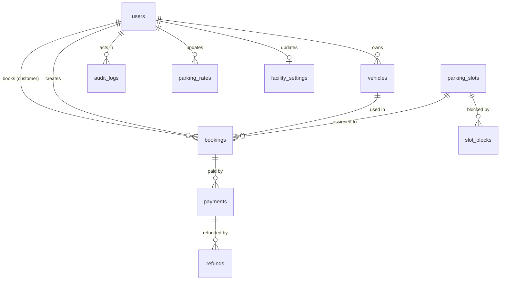

# ParkIt --- Database Design (PostgreSQL)

**Version:** 2.0 (revised after design review, 2026-11-15)\
**Database:** `parkit_db`\
**DBMS:** PostgreSQL 16+ (the only supported database)\
**Schema management:** Flyway versioned migrations\
**Timezone policy:** All instants are `TIMESTAMPTZ` stored in UTC;
facility rules are interpreted in `Asia/Kolkata` (BR-28).\
**Status:** Physical design baseline. Not yet applied to any database.

## 1. Design principles

-   Surrogate keys: `BIGINT GENERATED BY DEFAULT AS IDENTITY`.
-   Money: `NUMERIC(10,2)` mapped to Java `BigDecimal`.
-   Enumerations: `VARCHAR` + `CHECK`, mapped with
    `@Enumerated(EnumType.STRING)`. No PostgreSQL enum types.
-   Structured data: `JSONB`.
-   No hard deletes of business records; foreign keys use the default
    `NO ACTION` (restrict). Users, vehicles and slots are deactivated.
-   Booking, payment and refund states are separate state machines.
-   Payment and refund attempts are append-only records.
-   Rate snapshots are kept on each booking.
-   Balanced allocation is derived from immutable `confirmed_at`.
-   Double booking is prevented by pessimistic locking in the
    application **and** by exclusion constraints in the database.
-   Cross-row rules the database cannot express are enforced in services
    under the allocation lock (ARCHITECTURE.md §6).
-   Normalized to 3NF. Deliberate, documented denormalizations:
    `bookings.user_id` (kept consistent by a composite FK), rate
    snapshots and `booking_amount` (historical facts), and
    `overstay_amount` (assessed amount; collection status lives in
    `payments`).

## 2. Entity-relationship diagram



## 3. Tables

### 3.1 users

| Column | Type | Constraints |
|---|---|---|
| user_id | BIGINT identity | PK |
| name | VARCHAR(100) | NOT NULL |
| email | VARCHAR(150) | NOT NULL; unique on `lower(email)` |
| password_hash | VARCHAR(100) | NOT NULL (BCrypt) |
| phone | VARCHAR(20) | NOT NULL |
| role | VARCHAR(20) | NOT NULL, default CUSTOMER; CUSTOMER/ADMIN |
| is_active | BOOLEAN | NOT NULL, default TRUE |
| created_at, updated_at | TIMESTAMPTZ | NOT NULL |

### 3.2 vehicles

| Column | Type | Constraints |
|---|---|---|
| vehicle_id | BIGINT identity | PK |
| user_id | BIGINT | NOT NULL, FK users |
| registration_number | VARCHAR(20) | NOT NULL, UNIQUE; stored normalized (uppercase, no spaces/hyphens) |
| vehicle_type | VARCHAR(10) | NOT NULL; CAR/BIKE |
| is_electric | BOOLEAN | NOT NULL, default FALSE; only TRUE for CAR |
| description | VARCHAR(150) | NULL |
| is_active | BOOLEAN | NOT NULL, default TRUE |
| created_at, updated_at | TIMESTAMPTZ | NOT NULL |

`UNIQUE (vehicle_id, user_id)` supports the ownership composite FK from
bookings.

### 3.3 parking_slots

| Column | Type | Constraints |
|---|---|---|
| slot_id | BIGINT identity | PK |
| slot_number | VARCHAR(20) | NOT NULL, UNIQUE (display label) |
| sort_order | INTEGER | NOT NULL, UNIQUE, > 0 (allocation tie-break) |
| vehicle_type | VARCHAR(10) | NOT NULL; CAR/BIKE |
| operational_status | VARCHAR(20) | NOT NULL, default ACTIVE; ACTIVE/INACTIVE |
| created_at, updated_at | TIMESTAMPTZ | NOT NULL |

Operational status is not occupancy. Time-bounded blocking uses
`slot_blocks`.

### 3.4 bookings

| Column | Type | Constraints |
|---|---|---|
| booking_id | BIGINT identity | PK |
| booking_reference | VARCHAR(32) | NOT NULL, UNIQUE; random, ≥128-bit |
| user_id | BIGINT | NOT NULL, FK users (customer) |
| vehicle_id | BIGINT | NOT NULL; FK `(vehicle_id, user_id)` → vehicles |
| slot_id | BIGINT | NOT NULL, FK parking_slots (current slot) |
| created_by_user_id | BIGINT | NOT NULL, FK users (customer or admin) |
| scheduled_start, scheduled_end | TIMESTAMPTZ | NOT NULL; 15-min grid; 1 h ≤ duration ≤ 7 days |
| hold_expires_at | TIMESTAMPTZ | NOT NULL; set once at creation, never extended |
| confirmed_at | TIMESTAMPTZ | NULL; set once, never cleared |
| actual_check_in, actual_check_out | TIMESTAMPTZ | NULL |
| hourly_rate_snapshot, daily_rate_snapshot | NUMERIC(10,2) | NOT NULL, > 0 |
| booking_amount | NUMERIC(10,2) | NOT NULL, > 0 |
| overstay_amount | NUMERIC(10,2) | NOT NULL, default 0, ≥ 0 |
| overstay_minutes | INTEGER | NOT NULL, default 0, ≥ 0; open-hours minutes only (BR-19) |
| reassignment_wait_until | TIMESTAMPTZ | NULL; set when admin starts a reassignment wait (BR-26) |
| booking_status | VARCHAR(20) | NOT NULL; see §5 |
| cancelled_at | TIMESTAMPTZ | NULL |
| cancelled_by_user_id | BIGINT | NULL, FK users |
| cancellation_reason | VARCHAR(255) | NULL |
| created_at, updated_at | TIMESTAMPTZ | NOT NULL |
| version | BIGINT | NOT NULL, default 0 (JPA `@Version`) |

### 3.5 payments

| Column | Type | Constraints |
|---|---|---|
| payment_id | BIGINT identity | PK |
| booking_id | BIGINT | NOT NULL, FK bookings |
| payment_type | VARCHAR(20) | NOT NULL; BOOKING/OVERSTAY |
| payment_method | VARCHAR(20) | NOT NULL; ONLINE_SIMULATED/COUNTER_SIMULATED |
| amount | NUMERIC(10,2) | NOT NULL, > 0 |
| payment_status | VARCHAR(20) | NOT NULL; PENDING/SUCCESS/FAILED |
| idempotency_key | VARCHAR(80) | NOT NULL, UNIQUE |
| transaction_reference | VARCHAR(60) | NULL, UNIQUE (gateway reference) |
| failure_reason | VARCHAR(255) | NULL |
| recorded_by_user_id | BIGINT | NULL, FK users (admin for counter payments) |
| created_at | TIMESTAMPTZ | NOT NULL |
| completed_at | TIMESTAMPTZ | NULL iff PENDING |

Partial unique indexes: one SUCCESS and one PENDING payment per
`(booking_id, payment_type)`.

### 3.6 refunds

| Column | Type | Constraints |
|---|---|---|
| refund_id | BIGINT identity | PK |
| payment_id | BIGINT | NOT NULL, FK payments |
| amount | NUMERIC(10,2) | NOT NULL, > 0; equals payment amount (service rule) |
| refund_status | VARCHAR(20) | NOT NULL; PENDING/SUCCESS/FAILED |
| reason | VARCHAR(255) | NOT NULL |
| idempotency_key | VARCHAR(80) | NOT NULL, UNIQUE |
| refund_reference | VARCHAR(60) | NULL, UNIQUE |
| failure_reason | VARCHAR(255) | NULL |
| initiated_by_user_id | BIGINT | NULL, FK users (NULL = system) |
| created_at | TIMESTAMPTZ | NOT NULL |
| completed_at | TIMESTAMPTZ | NULL iff PENDING |

Partial unique index: at most one PENDING or SUCCESS refund per payment
(prevents duplicate refunds; FAILED refunds may be retried).

### 3.7 parking_rates

| Column | Type | Constraints |
|---|---|---|
| rate_id | BIGINT identity | PK |
| vehicle_type | VARCHAR(10) | NOT NULL, UNIQUE; CAR/BIKE |
| hourly_rate, daily_rate | NUMERIC(10,2) | NOT NULL, > 0 |
| updated_by_user_id | BIGINT | NULL, FK users (NULL = seeded by migration) |
| updated_at | TIMESTAMPTZ | NOT NULL |

One current row per category; history lives in booking snapshots and
the audit log.

### 3.8 slot_blocks

| Column | Type | Constraints |
|---|---|---|
| block_id | BIGINT identity | PK |
| slot_id | BIGINT | NOT NULL, FK parking_slots |
| start_time, end_time | TIMESTAMPTZ | NOT NULL; end > start |
| reason | VARCHAR(255) | NOT NULL |
| created_by_user_id | BIGINT | NOT NULL, FK users |
| created_at | TIMESTAMPTZ | NOT NULL |
| cancelled_at | TIMESTAMPTZ | NULL |
| cancelled_by_user_id | BIGINT | NULL, FK users; set together with cancelled_at |

A block is active while `cancelled_at IS NULL`.

### 3.9 facility_settings

| Column | Type | Constraints |
|---|---|---|
| setting_id | SMALLINT | PK, CHECK = 1 (single row) |
| facility_name | VARCHAR(150) | NOT NULL |
| opening_time, closing_time | TIME | NOT NULL; closing < opening means the window crosses midnight |
| open_24_hours | BOOLEAN | NOT NULL, default FALSE |
| timezone | VARCHAR(50) | NOT NULL, CHECK = 'Asia/Kolkata' |
| updated_by_user_id | BIGINT | NULL, FK users |
| updated_at | TIMESTAMPTZ | NOT NULL |

`opening_time = closing_time` is allowed only when `open_24_hours`.
Booking start and end must fall within open hours (BR-06.5).

### 3.10 audit_logs

| Column | Type | Constraints |
|---|---|---|
| log_id | BIGINT identity | PK |
| actor_type | VARCHAR(10) | NOT NULL; USER/SYSTEM |
| actor_user_id | BIGINT | FK users; NOT NULL iff actor_type = USER |
| action | VARCHAR(100) | NOT NULL |
| entity_type | VARCHAR(50) | NOT NULL |
| entity_id | BIGINT | NULL |
| details | JSONB | NULL (e.g. old/new slot on reassignment) |
| created_at | TIMESTAMPTZ | NOT NULL |

Audit rows are written in the same transaction as the action.

## 4. Relationships

-   users 1:M vehicles; users 1:M bookings (customer); users 1:M
    bookings (creator)
-   vehicles 1:M bookings (composite FK guarantees same owner)
-   parking_slots 1:M bookings; parking_slots 1:M slot_blocks
-   bookings 1:M payments (BOOKING and OVERSTAY); payments 1:M refunds
-   users 1:M audit_logs, slot_blocks, rate/settings updates

## 5. Booking status and consistency rules

Statuses: PENDING_PAYMENT, CONFIRMED, CHECKED_IN, COMPLETED, CANCELLED,
PAYMENT_EXPIRED, NO_SHOW. Transitions are defined in BUSINESS_RULES.md.

Enforced by CHECK constraints:

| Status | confirmed_at | actual_check_in | actual_check_out | cancelled_at |
|---|---|---|---|---|
| PENDING_PAYMENT | NULL | NULL | NULL | NULL |
| CONFIRMED | set | NULL | NULL | NULL |
| CHECKED_IN | set | set | NULL | NULL |
| COMPLETED | set | set | set | NULL |
| CANCELLED | any | NULL | NULL | set (+ reason) |
| PAYMENT_EXPIRED | NULL | NULL | NULL | NULL |
| NO_SHOW | set | NULL | NULL | NULL |

Payment and refund statuses: PENDING, SUCCESS, FAILED.

## 6. Overlap safeguards and concurrency

Overlap (half-open): `newStart < existingEnd AND newEnd > existingStart`.

**Layer 1 --- application locking (primary).** Every booking creation,
reassignment, block creation and check-in runs in one READ COMMITTED
transaction that locks the relevant `parking_slots` rows with
`SELECT ... FOR UPDATE` in ascending `slot_id` order, expires stale holds
it may conflict with, rechecks availability using the effective
occupancy interval (BR-08), then writes. Details: ARCHITECTURE.md §6.

**Layer 2 --- database constraints (safety net).**

-   `EXCLUDE` on `(slot_id, tstzrange(scheduled_start, scheduled_end, '[)'))`
    for statuses PENDING_PAYMENT, CONFIRMED, CHECKED_IN.
-   `EXCLUDE` on `(vehicle_id, tstzrange(...))` for the same statuses
    (no overlapping bookings per vehicle).
-   Partial unique index on `bookings(user_id)` where PENDING_PAYMENT
    (one active hold per customer).

Because `now()` cannot appear in a constraint predicate, an expired but
not-yet-swept PENDING_PAYMENT row would still trip these constraints.
Therefore the allocation transaction first marks conflicting stale holds
(`hold_expires_at <= now`) for the candidate slots, the vehicle and the
customer as PAYMENT_EXPIRED. The constraints do not cover the open-ended
occupancy of an overstaying vehicle or slot blocks; those are checked
under the lock.

A constraint violation (SQLSTATE `23P01` exclusion, `23505` unique) is
mapped to HTTP 409 Conflict.

## 7. Balanced allocation query (design)

Executed as a native query inside the locked transaction. Parameters come
from the injected `Clock`: `:now`, `:since = now − 30 days`.

```sql
SELECT ps.slot_id, ps.sort_order, COUNT(h.booking_id) AS allocation_count
FROM parking_slots ps
LEFT JOIN bookings h
       ON h.slot_id = ps.slot_id
      AND h.confirmed_at >= :since AND h.confirmed_at <= :now
WHERE ps.vehicle_type = :category
  AND ps.operational_status = 'ACTIVE'
  AND NOT EXISTS (                       -- scheduled conflicts
        SELECT 1 FROM bookings b
        WHERE b.slot_id = ps.slot_id
          AND (b.booking_status IN ('CONFIRMED','CHECKED_IN')
               OR (b.booking_status = 'PENDING_PAYMENT' AND b.hold_expires_at > :now))
          AND b.scheduled_start < :end AND b.scheduled_end > :start)
  AND NOT EXISTS (                       -- early check-in / overstay occupancy
        SELECT 1 FROM bookings o
        WHERE o.slot_id = ps.slot_id AND o.booking_status = 'CHECKED_IN'
          AND o.actual_check_in < :end
          AND (o.scheduled_end > :start OR o.scheduled_end <= :now))
  AND NOT EXISTS (                       -- active blocks
        SELECT 1 FROM slot_blocks sb
        WHERE sb.slot_id = ps.slot_id AND sb.cancelled_at IS NULL
          AND sb.start_time < :end AND sb.end_time > :start)
GROUP BY ps.slot_id, ps.sort_order
ORDER BY allocation_count ASC, ps.sort_order ASC;
```

The service takes the first row. The second `NOT EXISTS` treats an
overstaying vehicle (`scheduled_end <= now`) as occupying its slot
indefinitely (BR-08).

## 8. Pricing

Implemented in Java with `BigDecimal` per BR-20 (daily-rate cap on the
partial day). `float`/`double` are never used for money.

## 9. PostgreSQL DDL baseline

To be split into Flyway migrations (§10). Not yet applied.

```sql
CREATE EXTENSION IF NOT EXISTS btree_gist;

CREATE TABLE users (
  user_id       BIGINT GENERATED BY DEFAULT AS IDENTITY PRIMARY KEY,
  name          VARCHAR(100) NOT NULL,
  email         VARCHAR(150) NOT NULL,
  password_hash VARCHAR(100) NOT NULL,
  phone         VARCHAR(20)  NOT NULL,
  role          VARCHAR(20)  NOT NULL DEFAULT 'CUSTOMER' CHECK (role IN ('CUSTOMER','ADMIN')),
  is_active     BOOLEAN      NOT NULL DEFAULT TRUE,
  created_at    TIMESTAMPTZ  NOT NULL DEFAULT CURRENT_TIMESTAMP,
  updated_at    TIMESTAMPTZ  NOT NULL DEFAULT CURRENT_TIMESTAMP
);
CREATE UNIQUE INDEX ux_users_email_lower ON users (lower(email));

CREATE TABLE vehicles (
  vehicle_id          BIGINT GENERATED BY DEFAULT AS IDENTITY PRIMARY KEY,
  user_id             BIGINT NOT NULL REFERENCES users(user_id),
  registration_number VARCHAR(20) NOT NULL UNIQUE
                      CHECK (registration_number = upper(registration_number)
                             AND registration_number !~ '[[:space:]-]'),
  vehicle_type        VARCHAR(10) NOT NULL CHECK (vehicle_type IN ('CAR','BIKE')),
  is_electric         BOOLEAN NOT NULL DEFAULT FALSE,
  description         VARCHAR(150),
  is_active           BOOLEAN NOT NULL DEFAULT TRUE,
  created_at          TIMESTAMPTZ NOT NULL DEFAULT CURRENT_TIMESTAMP,
  updated_at          TIMESTAMPTZ NOT NULL DEFAULT CURRENT_TIMESTAMP,
  CONSTRAINT uq_vehicle_owner UNIQUE (vehicle_id, user_id),
  CONSTRAINT ck_electric_car CHECK (NOT is_electric OR vehicle_type = 'CAR')
);
CREATE INDEX ix_vehicles_user ON vehicles (user_id);

CREATE TABLE parking_slots (
  slot_id            BIGINT GENERATED BY DEFAULT AS IDENTITY PRIMARY KEY,
  slot_number        VARCHAR(20) NOT NULL UNIQUE,
  sort_order         INTEGER     NOT NULL UNIQUE CHECK (sort_order > 0),
  vehicle_type       VARCHAR(10) NOT NULL CHECK (vehicle_type IN ('CAR','BIKE')),
  operational_status VARCHAR(20) NOT NULL DEFAULT 'ACTIVE'
                     CHECK (operational_status IN ('ACTIVE','INACTIVE')),
  created_at         TIMESTAMPTZ NOT NULL DEFAULT CURRENT_TIMESTAMP,
  updated_at         TIMESTAMPTZ NOT NULL DEFAULT CURRENT_TIMESTAMP
);
CREATE INDEX ix_slots_category ON parking_slots (vehicle_type, operational_status, slot_id);

CREATE TABLE bookings (
  booking_id           BIGINT GENERATED BY DEFAULT AS IDENTITY PRIMARY KEY,
  booking_reference    VARCHAR(32) NOT NULL UNIQUE,
  user_id              BIGINT NOT NULL REFERENCES users(user_id),
  vehicle_id           BIGINT NOT NULL,
  slot_id              BIGINT NOT NULL REFERENCES parking_slots(slot_id),
  created_by_user_id   BIGINT NOT NULL REFERENCES users(user_id),
  scheduled_start      TIMESTAMPTZ NOT NULL,
  scheduled_end        TIMESTAMPTZ NOT NULL,
  hold_expires_at      TIMESTAMPTZ NOT NULL,
  confirmed_at         TIMESTAMPTZ,
  actual_check_in      TIMESTAMPTZ,
  actual_check_out     TIMESTAMPTZ,
  hourly_rate_snapshot NUMERIC(10,2) NOT NULL CHECK (hourly_rate_snapshot > 0),
  daily_rate_snapshot  NUMERIC(10,2) NOT NULL CHECK (daily_rate_snapshot > 0),
  booking_amount       NUMERIC(10,2) NOT NULL CHECK (booking_amount > 0),
  overstay_amount      NUMERIC(10,2) NOT NULL DEFAULT 0 CHECK (overstay_amount >= 0),
  overstay_minutes     INTEGER NOT NULL DEFAULT 0 CHECK (overstay_minutes >= 0),
  reassignment_wait_until TIMESTAMPTZ,
  booking_status       VARCHAR(20) NOT NULL CHECK (booking_status IN
                       ('PENDING_PAYMENT','CONFIRMED','CHECKED_IN','COMPLETED',
                        'CANCELLED','PAYMENT_EXPIRED','NO_SHOW')),
  cancelled_at         TIMESTAMPTZ,
  cancelled_by_user_id BIGINT REFERENCES users(user_id),
  cancellation_reason  VARCHAR(255),
  created_at           TIMESTAMPTZ NOT NULL DEFAULT CURRENT_TIMESTAMP,
  updated_at           TIMESTAMPTZ NOT NULL DEFAULT CURRENT_TIMESTAMP,
  version              BIGINT NOT NULL DEFAULT 0,

  CONSTRAINT fk_booking_vehicle_owner FOREIGN KEY (vehicle_id, user_id)
             REFERENCES vehicles (vehicle_id, user_id),
  CONSTRAINT ck_interval CHECK (scheduled_end > scheduled_start),
  CONSTRAINT ck_duration CHECK (scheduled_end - scheduled_start
             BETWEEN INTERVAL '1 hour' AND INTERVAL '7 days'),
  -- 15-minute grid (UTC+05:30 keeps local and UTC quarter-hours aligned)
  CONSTRAINT ck_grid CHECK (EXTRACT(EPOCH FROM scheduled_start)::BIGINT % 900 = 0
                        AND EXTRACT(EPOCH FROM scheduled_end)::BIGINT % 900 = 0),
  CONSTRAINT ck_checkout_order CHECK (actual_check_out IS NULL
             OR (actual_check_in IS NOT NULL AND actual_check_out >= actual_check_in)),
  CONSTRAINT ck_confirmed_at CHECK (
             (booking_status IN ('CONFIRMED','CHECKED_IN','COMPLETED','NO_SHOW')) <= (confirmed_at IS NOT NULL)
         AND (booking_status IN ('PENDING_PAYMENT','PAYMENT_EXPIRED')) <= (confirmed_at IS NULL)),
  CONSTRAINT ck_check_in CHECK (
             (booking_status IN ('CHECKED_IN','COMPLETED')) = (actual_check_in IS NOT NULL)),
  CONSTRAINT ck_check_out CHECK (
             (booking_status = 'COMPLETED') = (actual_check_out IS NOT NULL)),
  CONSTRAINT ck_overstay CHECK ((overstay_minutes > 0) = (overstay_amount > 0)
         AND (overstay_minutes = 0 OR booking_status = 'COMPLETED')),
  CONSTRAINT ck_reassign_wait CHECK (reassignment_wait_until IS NULL
             OR booking_status IN ('CONFIRMED','CHECKED_IN','COMPLETED','CANCELLED')),
  CONSTRAINT ck_cancelled CHECK (
             (booking_status = 'CANCELLED') = (cancelled_at IS NOT NULL)
         AND (cancelled_at IS NULL OR cancellation_reason IS NOT NULL)),

  CONSTRAINT ex_slot_overlap EXCLUDE USING gist (
             slot_id WITH =,
             tstzrange(scheduled_start, scheduled_end, '[)') WITH &&)
             WHERE (booking_status IN ('PENDING_PAYMENT','CONFIRMED','CHECKED_IN')),
  CONSTRAINT ex_vehicle_overlap EXCLUDE USING gist (
             vehicle_id WITH =,
             tstzrange(scheduled_start, scheduled_end, '[)') WITH &&)
             WHERE (booking_status IN ('PENDING_PAYMENT','CONFIRMED','CHECKED_IN'))
);
CREATE UNIQUE INDEX ux_one_hold_per_customer ON bookings (user_id)
       WHERE booking_status = 'PENDING_PAYMENT';
CREATE INDEX ix_bookings_user_start  ON bookings (user_id, scheduled_start DESC);
CREATE INDEX ix_bookings_vehicle     ON bookings (vehicle_id);
CREATE INDEX ix_bookings_creator     ON bookings (created_by_user_id);
CREATE INDEX ix_bookings_allocation  ON bookings (slot_id, confirmed_at);
CREATE INDEX ix_bookings_hold_sweep  ON bookings (hold_expires_at)
       WHERE booking_status = 'PENDING_PAYMENT';
CREATE INDEX ix_bookings_noshow_sweep ON bookings (scheduled_start)
       WHERE booking_status = 'CONFIRMED';
CREATE INDEX ix_bookings_checked_in  ON bookings (slot_id)
       WHERE booking_status = 'CHECKED_IN';
CREATE INDEX ix_bookings_status_start ON bookings (booking_status, scheduled_start);

CREATE TABLE payments (
  payment_id            BIGINT GENERATED BY DEFAULT AS IDENTITY PRIMARY KEY,
  booking_id            BIGINT NOT NULL REFERENCES bookings(booking_id),
  payment_type          VARCHAR(20) NOT NULL CHECK (payment_type IN ('BOOKING','OVERSTAY')),
  payment_method        VARCHAR(20) NOT NULL
                        CHECK (payment_method IN ('ONLINE_SIMULATED','COUNTER_SIMULATED')),
  amount                NUMERIC(10,2) NOT NULL CHECK (amount > 0),
  payment_status        VARCHAR(20) NOT NULL CHECK (payment_status IN ('PENDING','SUCCESS','FAILED')),
  idempotency_key       VARCHAR(80) NOT NULL UNIQUE,
  transaction_reference VARCHAR(60) UNIQUE,
  failure_reason        VARCHAR(255),
  recorded_by_user_id   BIGINT REFERENCES users(user_id),
  created_at            TIMESTAMPTZ NOT NULL DEFAULT CURRENT_TIMESTAMP,
  completed_at          TIMESTAMPTZ,
  CONSTRAINT ck_payment_completed CHECK ((payment_status = 'PENDING') = (completed_at IS NULL))
);
CREATE INDEX ix_payments_booking ON payments (booking_id);
CREATE INDEX ix_payments_completed ON payments (completed_at);
CREATE UNIQUE INDEX ux_one_success_per_type ON payments (booking_id, payment_type)
       WHERE payment_status = 'SUCCESS';
CREATE UNIQUE INDEX ux_one_pending_per_type ON payments (booking_id, payment_type)
       WHERE payment_status = 'PENDING';

CREATE TABLE refunds (
  refund_id            BIGINT GENERATED BY DEFAULT AS IDENTITY PRIMARY KEY,
  payment_id           BIGINT NOT NULL REFERENCES payments(payment_id),
  amount               NUMERIC(10,2) NOT NULL CHECK (amount > 0),
  refund_status        VARCHAR(20) NOT NULL CHECK (refund_status IN ('PENDING','SUCCESS','FAILED')),
  reason               VARCHAR(255) NOT NULL,
  idempotency_key      VARCHAR(80) NOT NULL UNIQUE,
  refund_reference     VARCHAR(60) UNIQUE,
  failure_reason       VARCHAR(255),
  initiated_by_user_id BIGINT REFERENCES users(user_id),
  created_at           TIMESTAMPTZ NOT NULL DEFAULT CURRENT_TIMESTAMP,
  completed_at         TIMESTAMPTZ,
  CONSTRAINT ck_refund_completed CHECK ((refund_status = 'PENDING') = (completed_at IS NULL))
);
CREATE INDEX ix_refunds_payment ON refunds (payment_id);
CREATE INDEX ix_refunds_completed ON refunds (completed_at);
CREATE UNIQUE INDEX ux_one_live_refund ON refunds (payment_id)
       WHERE refund_status IN ('PENDING','SUCCESS');

CREATE TABLE parking_rates (
  rate_id            BIGINT GENERATED BY DEFAULT AS IDENTITY PRIMARY KEY,
  vehicle_type       VARCHAR(10) NOT NULL UNIQUE CHECK (vehicle_type IN ('CAR','BIKE')),
  hourly_rate        NUMERIC(10,2) NOT NULL CHECK (hourly_rate > 0),
  daily_rate         NUMERIC(10,2) NOT NULL CHECK (daily_rate > 0),
  updated_by_user_id BIGINT REFERENCES users(user_id),
  updated_at         TIMESTAMPTZ NOT NULL DEFAULT CURRENT_TIMESTAMP
);

CREATE TABLE slot_blocks (
  block_id             BIGINT GENERATED BY DEFAULT AS IDENTITY PRIMARY KEY,
  slot_id              BIGINT NOT NULL REFERENCES parking_slots(slot_id),
  start_time           TIMESTAMPTZ NOT NULL,
  end_time             TIMESTAMPTZ NOT NULL,
  reason               VARCHAR(255) NOT NULL,
  created_by_user_id   BIGINT NOT NULL REFERENCES users(user_id),
  created_at           TIMESTAMPTZ NOT NULL DEFAULT CURRENT_TIMESTAMP,
  cancelled_at         TIMESTAMPTZ,
  cancelled_by_user_id BIGINT REFERENCES users(user_id),
  CONSTRAINT ck_block_interval CHECK (end_time > start_time),
  CONSTRAINT ck_block_cancel CHECK ((cancelled_at IS NULL) = (cancelled_by_user_id IS NULL))
);
CREATE INDEX ix_blocks_active ON slot_blocks
       USING gist (slot_id, tstzrange(start_time, end_time, '[)'))
       WHERE cancelled_at IS NULL;

CREATE TABLE facility_settings (
  setting_id         SMALLINT PRIMARY KEY CHECK (setting_id = 1),
  facility_name      VARCHAR(150) NOT NULL,
  opening_time       TIME NOT NULL,
  closing_time       TIME NOT NULL,
  open_24_hours      BOOLEAN NOT NULL DEFAULT FALSE,
  timezone           VARCHAR(50) NOT NULL DEFAULT 'Asia/Kolkata' CHECK (timezone = 'Asia/Kolkata'),
  updated_by_user_id BIGINT REFERENCES users(user_id),
  updated_at         TIMESTAMPTZ NOT NULL DEFAULT CURRENT_TIMESTAMP,
  CONSTRAINT ck_hours CHECK (open_24_hours OR opening_time <> closing_time)
);

CREATE TABLE audit_logs (
  log_id        BIGINT GENERATED BY DEFAULT AS IDENTITY PRIMARY KEY,
  actor_type    VARCHAR(10) NOT NULL CHECK (actor_type IN ('USER','SYSTEM')),
  actor_user_id BIGINT REFERENCES users(user_id),
  action        VARCHAR(100) NOT NULL,
  entity_type   VARCHAR(50) NOT NULL,
  entity_id     BIGINT,
  details       JSONB,
  created_at    TIMESTAMPTZ NOT NULL DEFAULT CURRENT_TIMESTAMP,
  CONSTRAINT ck_actor CHECK ((actor_type = 'USER') = (actor_user_id IS NOT NULL))
);
CREATE INDEX ix_audit_actor_time ON audit_logs (actor_user_id, created_at);
CREATE INDEX ix_audit_entity     ON audit_logs (entity_type, entity_id);
CREATE INDEX ix_audit_time       ON audit_logs (created_at);
```

Notes:

-   `(a) <= (b)` on booleans means "a implies b".
-   The `btree_gist` extension must be available (it ships with standard
    PostgreSQL); creating it may need a privileged role.
-   `updated_at` is maintained by JPA (`@PreUpdate` / auditing), not
    triggers.

## 10. Flyway migration plan

| Migration | Content |
|---|---|
| `V1__extensions.sql` | `btree_gist` |
| `V2__core_schema.sql` | All tables, constraints and indexes above |
| `V3__seed_reference_data.sql` | facility_settings row and CAR/BIKE rates (values supplied by the project owner) |

The first admin account is **not** seeded by migration (no password in
source control). It is created at application start-up from environment
variables if no ADMIN exists. Slot inventory is entered through the
admin UI or a separate seed migration once supplied.

## 11. Spring Boot / JPA mapping

-   Driver `org.postgresql:postgresql`; URL
    `jdbc:postgresql://localhost:5432/parkit_db`; credentials from
    environment variables.
-   `spring.jpa.hibernate.ddl-auto=validate`; Flyway owns the schema.
-   `spring.jpa.open-in-view=false`.
-   `spring.jpa.properties.hibernate.jdbc.time_zone=UTC`.
-   `TIMESTAMPTZ` ↔ `java.time.Instant`; `TIME` ↔ `LocalTime`;
    `NUMERIC` ↔ `BigDecimal`; `JSONB` ↔ `@JdbcTypeCode(SqlTypes.JSON)`.
-   `GenerationType.IDENTITY` for keys.
-   `@Version` on `Booking` for optimistic checks on non-locked updates.
-   Overlap, allocation and report queries are native SQL in
    repositories; locking uses `@Lock(PESSIMISTIC_WRITE)` or native
    `FOR UPDATE` with a lock timeout hint.

## 12. Change log

- 2.0: Removed all MySQL syntax (InnoDB, utf8mb4, ENUM, AUTO_INCREMENT,
  DATETIME, TINYINT, JSON). Added composite ownership FK, status
  consistency CHECKs, duration/grid CHECKs, exclusion constraints for
  slot and vehicle overlap, one-hold-per-customer index, idempotency keys
  and partial unique indexes for payments/refunds, payment method,
  cancellation and audit actor columns, slot sort_order and INACTIVE
  status, block cancellation, FK and sweep indexes, 24-hour flag,
  allocation query covering holds/occupancy/blocks, Flyway plan.
- 2.1: Added overstay_minutes and reassignment_wait_until with CHECKs;
  no-show sweep skips bookings whose reassignment wait is active;
  operating-hours semantics finalized. PostgreSQL remains the only DBMS.
